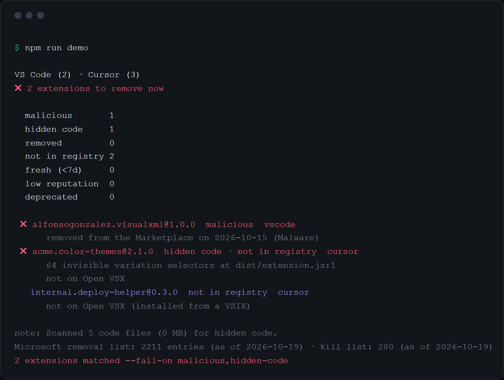
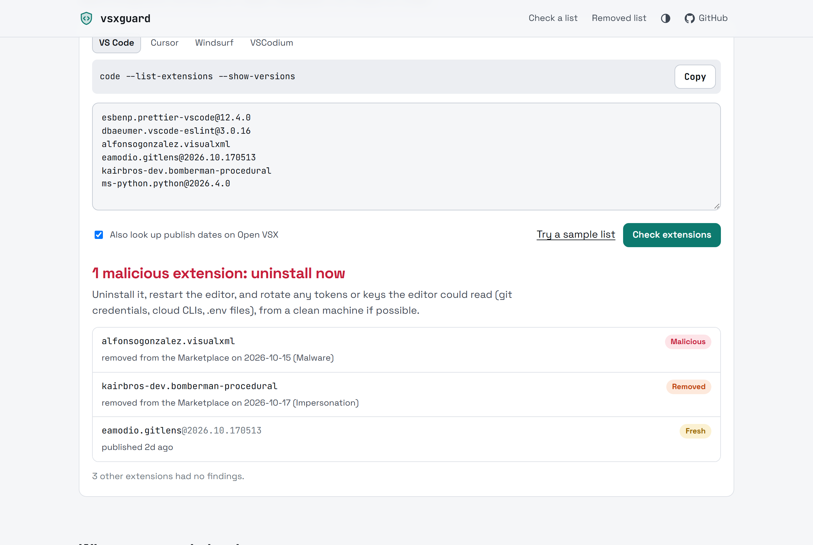

<div align="center">

# vsxguard

**Microsoft has pulled more than 2,000 extensions from the VS Code Marketplace. Is one still installed on your machine?**

vsxguard checks every VS Code-based editor you use (VS Code, Cursor, Windsurf, VSCodium, Positron, Kiro, Antigravity and remote servers) against Microsoft's removal and kill lists. It also scans extension code for the invisible-Unicode trick GlassWorm used to hide its payload. One command, a few seconds, no install.

[](https://feresbr1.github.io/vsxguard/)
[](https://github.com/feresbr1/vsxguard/releases/latest)
[](LICENSE)

```sh
npx github:feresbr1/vsxguard
```



<sub>Output of <code>npm run demo</code>, which builds a throwaway home folder containing a real removed-malware id, a GlassWorm-style file and a sideloaded extension.</sub>

</div>

---

## Why

When Microsoft removes a malicious or impersonating extension from the Marketplace, **it is not removed from the machines that already installed it**. Microsoft publishes two lists:

- [**RemovedPackages.md**](https://github.com/microsoft/vsmarketplace/blob/main/RemovedPackages.md): every extension it has taken down, with the date and reason. On 19 October 2026 that was **2,211 extensions**: 1,162 for impersonation, 621 for malware, and the rest for untrustworthy behaviour, spam and similar.
- **The kill list** VS Code downloads (`marketplace.json`): extensions VS Code force-uninstalls. On the same day it had **280 entries**. 2,104 removed extensions are not on it.

Editors that install from **Open VSX** instead of the Microsoft Marketplace use a different registry: Cursor (since mid-2025), Windsurf, VSCodium, Positron and others. And GlassWorm, the self-spreading campaign that hit Open VSX in October 2025, hid its code in Unicode variation selectors that are invisible in every editor and diff.

Nothing told you whether _your_ editors had any of this installed. vsxguard does.

## What it checks

| Check                  | What it means                                                                                                    | Source                                   |
| ---------------------- | ---------------------------------------------------------------------------------------------------------------- | ---------------------------------------- |
| 🟥 **Malicious**       | On VS Code's kill list, or removed by Microsoft as malware                                                       | Microsoft kill list + RemovedPackages.md |
| 🟥 **Hidden code**     | Runs of 8+ invisible variation-selector or tag characters in the extension's JS/TS files (GlassWorm's technique) | local file scan                          |
| 🟧 **Removed**         | Removed for impersonation, typo-squatting, spam or untrustworthy behaviour                                       | RemovedPackages.md                       |
| 🟪 **Not in registry** | The installed version is on neither the Marketplace nor Open VSX: sideloaded VSIX, unpublished, or private       | VS Marketplace + Open VSX                |
| 🟨 **Fresh**           | Installed version published inside your cooldown window (default 7 days)                                         | VS Marketplace / Open VSX                |
| 🟦 **Low reputation**  | Unverified publisher with fewer than 1,000 installs                                                              | VS Marketplace / Open VSX                |
| ⬜ **Deprecated**      | Deprecated (with the suggested replacement) or withdrawn by the owner                                            | kill list file + RemovedPackages.md      |

Each extension is checked in the registry its editor installs from (the Marketplace for VS Code, Open VSX for the forks), then in the other one.

## Quick start

Requires Node.js 18.17 or newer. The CLI is one bundled file with no dependencies.

```sh
npx github:feresbr1/vsxguard
```

or download `vsxguard.mjs` from the [latest release](https://github.com/feresbr1/vsxguard/releases/latest):

```sh
node vsxguard.mjs
```

### No terminal handy?

Open **https://feresbr1.github.io/vsxguard/**, run `code --list-extensions --show-versions` (or `cursor`, `windsurf`, `codium`), and paste the output. The browser check compares ids against the live removal list and looks up publish dates on Open VSX. The file scan and Marketplace lookups need the CLI. The site also has a searchable copy of Microsoft's full removal list.



## Options

```text
vsxguard [options]

  -c, --cooldown <days>        Flag versions published fewer than this many days ago (default 7)
  -f, --fail-on <checks>       Exit 1 when an extension matches (default "malicious,hidden-code")
                               malicious, hidden-code, removed, not-found, fresh,
                               low-reputation, deprecated, none
  -e, --editor <ids>           Only these editors, comma-separated
  -d, --extensions-dir <path>  Also scan this extensions folder (repeatable)
      --offline                Use the bundled lists only; skip registry lookups
      --no-scan                Skip the hidden-code file scan
  -a, --all                    List every extension, not only flagged ones
      --json                   Print the full report as JSON
      --markdown               Print a Markdown summary
      --markdown-file <path>   Also append the Markdown summary to a file
      --allow-incomplete       Exit 0/1 even if a registry could not be reached
      --no-color               Disable colours (NO_COLOR is also respected)
```

Exit codes: `0` nothing matched `--fail-on`, `1` something matched, `2` usage error, no editors found, or a registry was unreachable.

### Examples

```sh
# Everything installed, flagged or not
npx github:feresbr1/vsxguard --all

# Only the AI editors
npx github:feresbr1/vsxguard --editor cursor,windsurf,kiro

# Strict: fail on anything removed or unknown, e.g. in a fleet-check script
npx github:feresbr1/vsxguard --fail-on malicious,hidden-code,removed,not-found

# A portable install or a dev container's extensions folder
npx github:feresbr1/vsxguard --extensions-dir /path/to/extensions

# Machine-readable
npx github:feresbr1/vsxguard --json | jq '.extensions[] | select(.flags | length > 0) | .id'
```

## Where it looks

All paths are under your home directory, on macOS, Linux and Windows:

| Editor                                  | Folder                                                                                                                    |
| --------------------------------------- | ------------------------------------------------------------------------------------------------------------------------- |
| VS Code / Insiders                      | `.vscode/extensions`, `.vscode-insiders/extensions`                                                                       |
| VSCodium                                | `.vscode-oss/extensions`                                                                                                  |
| Cursor                                  | `.cursor/extensions`                                                                                                      |
| Windsurf                                | `.windsurf/extensions`                                                                                                    |
| Positron, Kiro, Trae, Antigravity, Void | `.positron/`, `.kiro/`, `.trae/`, `.antigravity/`, `.void-editor/` + `extensions`                                         |
| Remote servers (SSH, WSL, containers)   | `.vscode-server/`, `.vscode-server-insiders/`, `.cursor-server/`, `.windsurf-server/`, `.vscodium-server/` + `extensions` |

Run vsxguard on a remote host to check that host's server extensions. Folders VS Code has marked for deletion (`.obsolete`) are skipped. When the same version is installed in several editors, every copy is scanned.

## If something is flagged

1. **Malicious or hidden code:** uninstall the extension in every editor where it is listed, then restart the editor. Assume anything the editor could read was exposed: rotate git credentials, cloud CLI tokens, SSH keys and secrets from `.env` files, preferably from another machine.
2. **Removed** (impersonation, typo-squatting): uninstall it and install the real extension from its publisher.
3. **Not in registry:** fine if you installed a VSIX on purpose (internal tools). Otherwise find out where it came from.
4. **Fresh:** nothing is wrong yet. VS Code 1.123+ can delay auto-updates (`extensions.autoUpdateDelay`); other editors may not.

## Privacy

- The CLI reads extension folders locally. It sends only extension ids and versions to the VS Code Marketplace and Open VSX, and downloads Microsoft's two public lists.
- The website has no backend, cookies or analytics. Pasted lists stay in the tab. Only ids and versions are sent to Open VSX for publish dates (you can turn that off).

## How it works

```
~/.vscode/extensions, ~/.cursor/extensions, …  ──▶  package.json + extensions.json  ──▶  id@version list
   │                                                                                       │
   ├─▶ scan *.js / *.ts for invisible-character runs           Microsoft RemovedPackages.md + kill list ◀─┤
   │                                                           VS Marketplace / Open VSX lookups      ◀─┘
   └──────────────────────────────▶ findings per extension ◀──────────────────────────────┘
```

A snapshot of both lists is bundled ([`data/lists-snapshot.json`](data/lists-snapshot.json), refreshed with `npm run update-data`). It is used with `--offline`, when the live lists are unreachable, and on the website for the kill list (which is not CORS-readable).

## Limitations

- vsxguard reports what is _known_. A malicious extension that Microsoft has not removed and that does not use invisible characters will not be flagged as malicious. That is why the _fresh_, _not in registry_ and _low reputation_ checks exist.
- The hidden-code scan looks for one well-documented technique (long runs of variation selectors or tag characters). It is not a general malware scanner. For deep static analysis of a VSIX before installing it, see Trail of Bits' [vsix-audit](https://github.com/trailofbits/vsix-audit).
- Open VSX has no public removal list, so extensions removed only from Open VSX are reported as _not in registry_, not as _removed_.
- Portable installs and custom `--extensions-dir` locations configured inside an editor are not auto-detected; pass them with `--extensions-dir`.

## Development

```sh
git clone https://github.com/feresbr1/vsxguard && cd vsxguard
npm install
npm run build:cli && npm run demo   # see a detection
npm run dev                         # website at http://localhost:5173/vsxguard/
npm test                            # unit + integration tests (network mocked)
LIVE=1 npm test                     # also hit Microsoft's lists, the Marketplace and Open VSX
npm run build:web && npm run test:e2e   # Playwright, desktop + mobile
npm run check                       # format, lint, typecheck, tests, build
```

`dist/cli/vsxguard.mjs` is committed so `npx github:feresbr1/vsxguard` works without a build step. `npm run deploy` publishes the website to the `gh-pages` branch. See [CONTRIBUTING.md](CONTRIBUTING.md) and [docs/PRODUCT_DECISIONS.md](docs/PRODUCT_DECISIONS.md).

## Links

- Website: https://feresbr1.github.io/vsxguard/
- Releases: https://github.com/feresbr1/vsxguard/releases
- Issues: https://github.com/feresbr1/vsxguard/issues
- Security policy: [SECURITY.md](SECURITY.md)

## License

[MIT](LICENSE). The removal list is published by Microsoft in [microsoft/vsmarketplace](https://github.com/microsoft/vsmarketplace).
